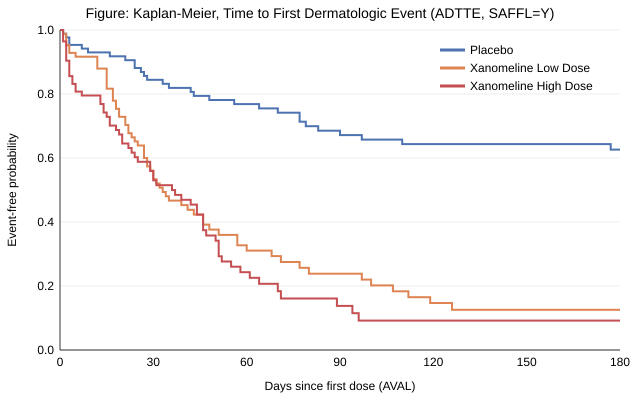

# CDISC Pilot 真实数据示例（自动生成）

> 本文件由 `python scripts/build_cdisc_learning_examples.py` 生成，请勿手工修改。
> 数据全部来自 GitHub 公开仓库（固定 commit），用于学习手册 `docs/learning/` 中的讲解。
> SDTM: `pharmaverse/pharmaversesdtm@7ec53ea`；ADaM: `cdisc-org/sdtm-adam-pilot-project@667511d`（CDISCPILOT01）。

## 1. 数据清单

| 数据集 | 标准 | 行数 | 变量数 | SHA256(前12位) | 来源 |
|---|---|---|---|---|---|
| DM | SDTM | 306 | 28 | bf0a821024b5 | pharmaverse/pharmaversesdtm |
| EX | SDTM | 591 | 17 | b8042858279e | pharmaverse/pharmaversesdtm |
| DS | SDTM | 850 | 13 | 9c90933c42a0 | pharmaverse/pharmaversesdtm |
| AE | SDTM | 1191 | 35 | b574a33fb669 | pharmaverse/pharmaversesdtm |
| ADSL | ADaM | 254 | 48 | 5f8815fc77b6 | cdisc-org/sdtm-adam-pilot-project |
| ADAE | ADaM | 1191 | 55 | 9bd195ecfde5 | cdisc-org/sdtm-adam-pilot-project |
| ADQSADAS | ADaM | 12463 | 40 | a832aa6eae92 | cdisc-org/sdtm-adam-pilot-project |
| ADTTE | ADaM | 254 | 26 | 40d0213aecde | cdisc-org/sdtm-adam-pilot-project |

## 2. 为什么 DM 有 306 人而 ADSL 只有 254 人？

| DM.ARM | 受试者数 |
|---|---|
| Placebo | 86 |
| Xanomeline High Dose | 84 |
| Xanomeline Low Dose | 84 |
| Screen Failure | 52 |

DM 收录了所有签署知情同意的人（含筛选失败 Screen Failure），而 CDISC Pilot 的 ADSL 只保留进入随机化的受试者。

## 3. 一名受试者（01-701-1015）从 SDTM 到 ADaM 的完整追溯

**① SDTM.DM（一人一行，原始“收集到的”事实）**

| USUBJID | ARM | ACTARM | RFSTDTC | RFENDTC | BRTHDTC | AGE | SEX | RACE | SITEID |
|---|---|---|---|---|---|---|---|---|---|
| 01-701-1015 | Placebo | Placebo | 2014-01-02 | 2014-07-02 | 1950-12-26 | 63 | F | WHITE | 701 |

**② SDTM.EX（给药记录，一人多行）**

| USUBJID | EXSEQ | EXTRT | EXDOSE | EXDOSU | EXSTDTC | EXENDTC | VISIT |
|---|---|---|---|---|---|---|---|
| 01-701-1015 | 1 | PLACEBO | 0 | mg | 2014-01-02 | 2014-01-16 | BASELINE |
| 01-701-1015 | 2 | PLACEBO | 0 | mg | 2014-01-17 | 2014-06-18 | WEEK 2 |
| 01-701-1015 | 3 | PLACEBO | 0 | mg | 2014-06-19 | 2014-07-02 | WEEK 24 |

**③ ADaM.ADSL（一人一行，加上了治疗日期、人群标志、分组等“分析用”变量）**

| USUBJID | TRT01P | TRT01A | TRTSDT | TRTEDT | TRTDUR | AGEGR1 | SAFFL | ITTFL | EFFFL | COMP24FL | MMSETOT |
|---|---|---|---|---|---|---|---|---|---|---|---|
| 01-701-1015 | Placebo | Placebo | 2014-01-02 | 2014-07-02 | 182 | <65 | Y | Y | Y | Y | 23 |

**④ SDTM.AE（不良事件原始记录）**

| USUBJID | AESEQ | AETERM | AEDECOD | AEBODSYS | AESTDTC | AESEV | AESER |
|---|---|---|---|---|---|---|---|
| 01-701-1015 | 1 | APPLICATION SITE ERYTHEMA | APPLICATION SITE ERYTHEMA | GENERAL DISORDERS AND ADMINISTRATION SITE CONDITIONS | 2014-01-03 | MILD | N |
| 01-701-1015 | 2 | APPLICATION SITE PRURITUS | APPLICATION SITE PRURITUS | GENERAL DISORDERS AND ADMINISTRATION SITE CONDITIONS | 2014-01-03 | MILD | N |
| 01-701-1015 | 3 | DIARRHOEA | DIARRHOEA | GASTROINTESTINAL DISORDERS | 2014-01-09 | MILD | N |

**⑤ ADaM.ADAE（加上 TRTA、ASTDY、TRTEMFL 等分析变量）**

| USUBJID | AESEQ | TRTA | AEDECOD | ASTDT | ASTDY | TRTEMFL | AOCCPFL | SAFFL |
|---|---|---|---|---|---|---|---|---|
| 01-701-1015 | 1 | Placebo | APPLICATION SITE ERYTHEMA | 2014-01-03 | 2.0 | Y | Y | Y |
| 01-701-1015 | 2 | Placebo | APPLICATION SITE PRURITUS | 2014-01-03 | 2.0 | Y | Y | Y |
| 01-701-1015 | 3 | Placebo | DIARRHOEA | 2014-01-09 | 8.0 | Y | Y | Y |

**⑥ ADaM.ADQSADAS（BDS 结构：一人 × 参数 × 访视 一行）**

| USUBJID | PARAMCD | AVISIT | ADY | AVAL | BASE | CHG | ABLFL | ANL01FL | DTYPE |
|---|---|---|---|---|---|---|---|---|---|
| 01-701-1015 | ACTOT | Baseline | 1 | 13.0 | 13.0 |  | Y | Y |  |
| 01-701-1015 | ACTOT | Week 8 | 63 | 8.0 | 13.0 | -5.0 |  | Y |  |
| 01-701-1015 | ACTOT | Week 16 | 126 | 11.0 | 13.0 | -2.0 |  | Y |  |
| 01-701-1015 | ACTOT | Week 24 | 168 | 8.0 | 13.0 | -5.0 |  | Y |  |

**⑦ ADaM.ADTTE（时间-事件：AVAL=天数，CNSR=0 表示事件发生）**

| USUBJID | PARAMCD | STARTDT | ADT | AVAL | CNSR | EVNTDESC | SRCDOM | SRCVAR | SRCSEQ |
|---|---|---|---|---|---|---|---|---|---|
| 01-701-1015 | TTDE | 2014-01-02 | 2014-01-03 | 2 | 0 | Dematologic Event Occured | ADAE | ASTDT | 1.0 |

## 4. 独立复算 QC：用 SDTM 重新推导 ADSL 关键变量，再与官方 ADSL 比对

我方推导受试者 254 人，官方 ADSL 254 人，匹配上 254 人。

| 变量 | 推导规则 | 比较受试者数 | 一致 | 不一致 | 一致率 |
|---|---|---|---|---|---|
| AGEGR1 | v1 | 254 | 254 | 0 | 100.0% |
| SAFFL | v1 | 254 | 254 | 0 | 100.0% |
| TRTSDT | v1 | 254 | 254 | 0 | 100.0% |
| TRTEDT | v1 = max(EXENDTC) | 254 | 248 | 6 | 97.6% |
| TRTDUR | v1 | 254 | 248 | 6 | 97.6% |
| TRTEDT | v2 = 末次EXENDTC缺失时用RFENDTC | 254 | 254 | 0 | 100.0% |
| TRTDUR | v2 | 254 | 254 | 0 | 100.0% |

规则（教学版）：TRTSDT=min(EX.EXSTDTC)，TRTDUR=TRTEDT−TRTSDT+1，AGEGR1: <65 / 65-80 / >80，SAFFL=有任何给药记录。

v1 的 6 个不一致受试者（01-704-1233, 01-705-1018, 01-705-1031, 01-705-1303, 01-705-1377, 01-705-1382）末次 EX 记录 EXENDTC 为空：简单取 max 会拿到更早那条记录的结束日期。官方 ADSL 用 DM.RFENDTC 补齐——把这条规则写进 spec 后（v2）即 100% 一致。这正是双人独立编程（double programming）发现 spec 歧义的典型过程，见手册第 6 章。

## 5. Table：分析人群汇总（ADSL，按 TRT01P）

| 人群 | Placebo | Xan Low | Xan High | 合计 |
|---|---|---|---|---|
| 随机化/ITT (ITTFL) | 86 | 84 | 84 | 254 |
| 安全性 (SAFFL) | 86 | 84 | 84 | 254 |
| 疗效 (EFFFL) | 79 | 81 | 74 | 234 |
| 完成第24周 (COMP24FL) | 60 | 28 | 30 | 118 |

## 6. Table 14-2.01 风格：人口学与基线特征（ITT，按 TRT01P）

| 项目 | Placebo | Xan Low | Xan High | 合计 |
|---|---|---|---|---|
| N | 86 | 84 | 84 | 254 |
| 年龄 Mean (SD) | 75.2 (8.59) | 75.7 (8.29) | 74.4 (7.89) | 75.1 (8.25) |
| 年龄 Median | 76.0 | 77.5 | 76.0 | 77.0 |
| 年龄 Min, Max | 52, 89 | 51, 88 | 56, 88 | 51, 89 |
|   年龄组 <65 | 14 (16.3%) | 8 (9.5%) | 11 (13.1%) | 33 (13.0%) |
|   年龄组 65-80 | 42 (48.8%) | 47 (56.0%) | 55 (65.5%) | 144 (56.7%) |
|   年龄组 >80 | 30 (34.9%) | 29 (34.5%) | 18 (21.4%) | 77 (30.3%) |
|   性别 女 | 53 (61.6%) | 50 (59.5%) | 40 (47.6%) | 143 (56.3%) |
|   性别 男 | 33 (38.4%) | 34 (40.5%) | 44 (52.4%) | 111 (43.7%) |
|   种族 WHITE | 78 (90.7%) | 78 (92.9%) | 74 (88.1%) | 230 (90.6%) |
|   种族 BLACK OR AFRICAN AMERICAN | 8 (9.3%) | 6 (7.1%) | 9 (10.7%) | 23 (9.1%) |
|   种族 AMERICAN INDIAN OR ALASKA NATIVE | 0 (0.0%) | 0 (0.0%) | 1 (1.2%) | 1 (0.4%) |

## 7. Table 14-5.01 风格：TEAE 总览（安全性人群，按实际治疗 TRTA）

| 类别 | Placebo (N=86) | Xan Low (N=84) | Xan High (N=84) |
|---|---|---|---|
| 至少1个TEAE的受试者 | 65 (75.6%) | 77 (91.7%) | 76 (90.5%) |
| 至少1个严重TEAE (AESER=Y) | 0 (0.0%) | 1 (1.2%) | 2 (2.4%) |
| 至少1个重度TEAE (AESEV=SEVERE) | 5 (5.8%) | 16 (19.0%) | 8 (9.5%) |
| 因AE停止研究 (ADSL.DSRAEFL=Y) | 8 (9.3%) | 44 (52.4%) | 40 (47.6%) |
| TEAE 事件数 (records) | 281 | 412 | 433 |

### 按 PT 发生率前 10（受试者数，非事件数）

| SOC | PT (AEDECOD) | Placebo (N=86) | Xan Low (N=84) | Xan High (N=84) |
|---|---|---|---|---|
| SKIN AND SUBCUTANEOUS TISSUE DISORDERS | PRURITUS | 8 (9.3%) | 21 (25.0%) | 26 (31.0%) |
| GENERAL DISORDERS AND ADMINISTRATION SITE CONDITIONS | APPLICATION SITE PRURITUS | 6 (7.0%) | 22 (26.2%) | 22 (26.2%) |
| SKIN AND SUBCUTANEOUS TISSUE DISORDERS | ERYTHEMA | 8 (9.3%) | 14 (16.7%) | 14 (16.7%) |
| GENERAL DISORDERS AND ADMINISTRATION SITE CONDITIONS | APPLICATION SITE ERYTHEMA | 3 (3.5%) | 12 (14.3%) | 15 (17.9%) |
| SKIN AND SUBCUTANEOUS TISSUE DISORDERS | RASH | 5 (5.8%) | 13 (15.5%) | 9 (10.7%) |
| GENERAL DISORDERS AND ADMINISTRATION SITE CONDITIONS | APPLICATION SITE IRRITATION | 3 (3.5%) | 9 (10.7%) | 9 (10.7%) |
| NERVOUS SYSTEM DISORDERS | DIZZINESS | 2 (2.3%) | 8 (9.5%) | 11 (13.1%) |
| GENERAL DISORDERS AND ADMINISTRATION SITE CONDITIONS | APPLICATION SITE DERMATITIS | 5 (5.8%) | 9 (10.7%) | 7 (8.3%) |
| GASTROINTESTINAL DISORDERS | DIARRHOEA | 9 (10.5%) | 4 (4.8%) | 4 (4.8%) |
| CARDIAC DISORDERS | SINUS BRADYCARDIA | 2 (2.3%) | 7 (8.3%) | 8 (9.5%) |

## 8. Table 14-3.01 风格：ADAS-Cog(11) 第 24 周较基线变化（LOCF，疗效人群）

| 组别 | n | 基线 Mean (SD) | 第24周 Mean (SD) | 变化值 CHG Mean (SD) | 其中 LOCF 填补行 |
|---|---|---|---|---|---|
| Placebo | 79 | 24.1 (12.19) | 26.7 (13.79) | 2.5 (5.80) | 14 |
| Xan Low | 81 | 24.4 (12.92) | 26.4 (13.18) | 2.0 (5.55) | 32 |
| Xan High | 74 | 21.3 (11.74) | 22.8 (12.48) | 1.5 (4.26) | 33 |

ANCOVA：CHG ~ 治疗 + 中心组(SITEGR1) + 基线(BASE)，n=234，残差自由度=220。

| 比较 | LS均值差 | SE | 95% CI | p值 |
|---|---|---|---|---|
| Xan Low vs Placebo | -0.47 | 0.82 | (-2.08, 1.15) | 0.5688 |
| Xan High vs Placebo | -1.01 | 0.84 | (-2.66, 0.65) | 0.2326 |

剂量-反应检验（TRTPN 作为连续变量 0/54/81）p = 0.2447。

## 9. Figure：首次皮肤类不良事件时间（ADTTE，KM）

| 组别 | N | 事件数 (CNSR=0) | 删失数 (CNSR=1) | KM中位时间(天) |
|---|---|---|---|---|
| Placebo | 86 | 29 | 57 | 未达到 |
| Xan Low | 84 | 62 | 22 | 33 |
| Xan High | 84 | 61 | 23 | 36 |

Log-rank 检验（3 组）：χ² = 60.27，df = 2，p = 8.2e-14。

## 10. Listing：严重不良事件列表（前 10 行）

| TRTA | USUBJID | AGE | SEX | AEDECOD | ASTDT | ASTDY | AESEV | AEOUT | AEREL |
|---|---|---|---|---|---|---|---|---|---|
| Xanomeline High Dose | 01-709-1424 | 77 | M | SYNCOPE | 2013-03-07 | 5.0 | MODERATE | RECOVERED/RESOLVED | POSSIBLE |
| Xanomeline High Dose | 01-718-1371 | 69 | F | PARTIAL SEIZURES WITH SECONDARY GENERALISATION | 2013-06-02 | 38.0 | SEVERE | RECOVERED/RESOLVED | NONE |
| Xanomeline Low Dose | 01-718-1170 | 80 | F | SYNCOPE | 2013-10-12 | 27.0 | SEVERE | RECOVERED/RESOLVED | PROBABLE |
